<div align="center">

<a href="https://github.com/Anoop-Kumar-Yadav"></a>

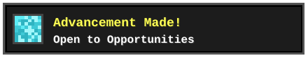

<!-- NEW: typing animation -->
<a href="https://github.com/Anoop-Kumar-Yadav"></a>

<p>
  
  
  
  
</p>

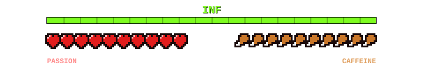

<!-- NEW: animated XP bar -->


</div>

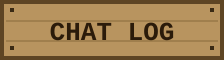

<div align="center"></div>

<div align="center"></div>

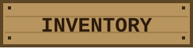

<div align="center"></div>

<!-- NEW: bobbing items -->
<div align="center"></div>

<details>
<summary><b>📦 Open the Tech Stack chest</b></summary>
<br/>

<div align="center">
  <br/>
  <br/>
  
</div>

| Slot | Items |
|:--|:--|
| Languages | JavaScript, TypeScript, Python |
| Frontend | React, Next.js, Tailwind CSS, HTML5, CSS3 |
| Backend | Node.js, Express.js, Django, Flask |
| Databases | MongoDB, PostgreSQL, MySQL, SQLite |
| DevOps | Docker, Git, Linux |
| Tools | VS Code, Postman |

</details>

<div align="center"></div>

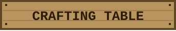

<div align="center"></div>

<div align="center"></div>

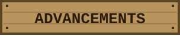

<div align="center">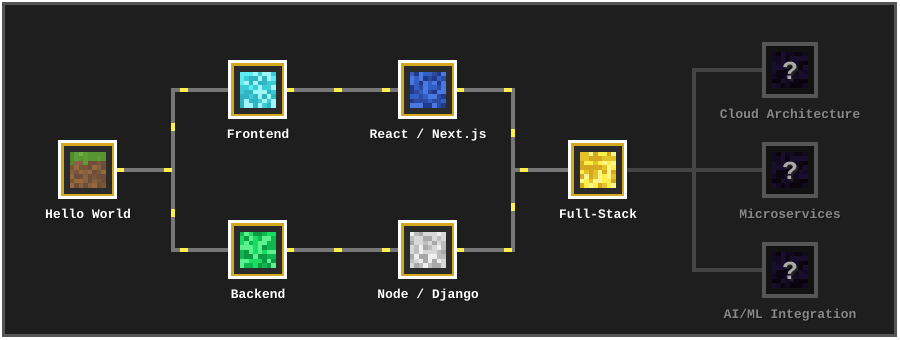</div>

<div align="center"></div>

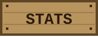

<div align="center">
  
  
  <br/>
  
</div>

<!-- NEW: contribution snake (needs .github/workflows/snake.yml) -->
<div align="center">
  
</div>

<details>
<summary><b>🗺️ Open the contribution map</b></summary>
<br/>

<div align="center">
  
  <br/>
  
  
</div>

</details>

<details>
<summary><b>⌨️ Open the command block</b></summary>

```text
/gamemode creative          -> building full-stack web applications
/tp @s cloud-architecture   -> currently learning
/give @s diamond            -> collaborations welcome
/say Clean code, scalable architecture, exceptional UX.
```

</details>

<div align="center"></div>

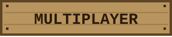

<!-- NEW: hover-lift micro animation via animated SVG-free approach: badge style swap -->
<div align="center">
  <a href="https://www.linkedin.com/in/anoop-kumar-yadav-9b31b3283"></a>
  <a href="https://youtube.com/@ByteBrilliancez"></a>
  <a href="https://x.com/AnoopKumar75357"></a>
  <a href="https://wa.me/918795082897"></a>
  <a href="mailto:anoop9569110314@gmail.com"></a>
</div>

<!-- NEW: animated wave footer -->
<div align="center"></div>
